# Aquarea Clima · Alaska

**La dashboard completa per Panasonic Aquarea e HeishaMon WT32-ETH01.**



Anteprima del disegno realmente usato dalla dashboard, senza dati di un impianto privato.

Questo è il progetto **Aquarea Clima**: sinottico generale, circuiti della pompa di calore, controlli PDC, energia, storico e analisi COP. Il Coordinatore climatico è un componente collegato, non la dashboard principale.

Firmware associato: **[HeishaMon WT32-ETH01 Ethernet + CZ-TAW1](https://github.com/alaska651-png/heishamon-wt32-eth01-cz)**. Il firmware resta nel proprio repository; questa pubblicazione non lo modifica né lo ridistribuisce.

## La dashboard pubblicata

| Sezione | Contenuto |
| --- | --- |
| Sinottico generale | Unità esterna/interna, circuito frigorifero, ACS, buffer, mandata/ritorno e zone Z1/Z2 |
| Circuiti | Viste frigorifera e idraulica, compressore, ventilatori, valvole e circolatori |
| Zone Z1/Z2 | Fan-coil estivi, pavimento miscelato invernale, target e curva climatica |
| ACS e buffer | Temperature, setpoint e differenziali distinti |
| Resistenze e defrost | Stati disponibili e diagnostica, senza inventare misure mancanti |
| Controlli PDC | Quiet, ACS, differenziale buffer e curva Z2; anteprima, conferma e riscontro |
| Energia e COP | Potenze, bilanci, grafici e dettaglio giornaliero |
| Analisi COP e modulazione | Cicli, avviamenti, frequenza compressore, confronti e copertura dei dati |
| Statistiche e storico | Finestre giorno/7/30 giorni, frecce sulle date e CSV/JSON |
| Stanze | Temperature, richieste e stato relè riportato da HA; accesso al manuale temporaneo |
| Navigazione | Coordinatore ↔ Aquarea Clima, Home HA e firma Alaska |

Le viste principali sono in [`aquarea-clima/web/`](aquarea-clima/web/). Il server autenticato è [`aquarea-clima/server.py`](aquarea-clima/server.py).

## Scaricare il lavoro completo

Nelle [release](https://github.com/alaska651-png/alaska-aquarea/releases) sono disponibili:

- **`aquarea-clima-1.1.0.zip`**: dashboard web completa, server, servizi collegati, Coordinatore, gateway HA, esempi e documentazione.
- **`alaska-aquarea.js`**: risorsa frontend HACS, con la card principale Aquarea Clima e la card del Coordinatore.
- **`SHA256SUMS.txt`**: checksum degli artefatti.

Il pacchetto contiene codice e modelli generici, non credenziali, configurazione privata, storico o approvazioni dell'impianto originale. È una distribuzione dei sorgenti: servizi e configurazioni richiedono installazione separata.

## HACS: aprire Aquarea Clima

1. In **HACS → menu → Repository personalizzati**, aggiungere `https://github.com/alaska651-png/alaska-aquarea`, categoria **Dashboard**.
2. Scaricare **Alaska · Aquarea Clima** e ricaricare il browser.
3. Se necessario registrare `/hacsfiles/alaska-aquarea/alaska-aquarea.js` come modulo JavaScript.
4. Con servizi e gateway già configurati, creare la vista principale:

```yaml
title: Aquarea Clima
views:
  - title: Impianto
    path: impianto
    type: panel
    cards:
      - type: custom:aquarea-clima-host
```

[Aggiungi Aquarea Clima a HACS](https://my.home-assistant.io/redirect/hacs_repository/?owner=alaska651-png&repository=alaska-aquarea&category=plugin)

**HACS distribuisce le card frontend, non avvia i servizi Docker e non configura il gateway.** Senza backend Aquarea Clima e sessione HA la card non può mostrare il sinottico. Vedere [installazione Aquarea Clima](docs/AQUAREA_CLIMA.md). Mappatura e collaudo rimangono locali.

## Coordinatore collegato

La card `custom:coordinatore-climatico-card` rimane inclusa per la vista separata del Coordinatore: Comfort/Eco, programmazione, Media per piano e timer stanza **0/15/30/45/60/90/120 minuti**. Zero annulla; la scadenza restituisce il controllo all'automatico. [Configurazione del Coordinatore](docs/BACKEND.md).

Non caricare insieme la vecchia risorsa manuale e quella HACS. Non avviare un secondo coordinatore sugli stessi relè. Le versioni pubbliche usano chiavi stanza generiche: conservare versioni e mappatura compatibili durante una migrazione.

## Verifiche e limiti

CI verifica frontend, asset del sinottico, servizi Python, 64 test del Coordinatore e struttura HACS. I test non si collegano alla pompa di calore. Questa release non certifica una nuova installazione, il movimento fisico delle testine o il raffrescamento. I servizi completi non sono installati automaticamente da HACS.

[Architettura](docs/ARCHITECTURE.md) · [Changelog](CHANGELOG.md) · [Sicurezza](SECURITY.md) · [Licenza MIT](LICENSE)

Progetto indipendente; Panasonic e HeishaMon indicano compatibilità, non un'affiliazione ufficiale.
